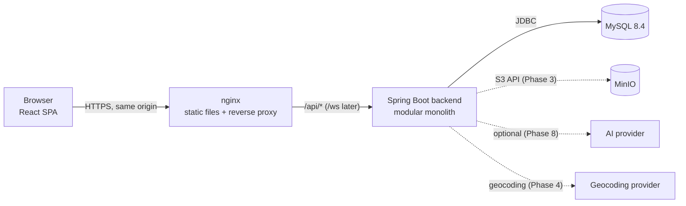
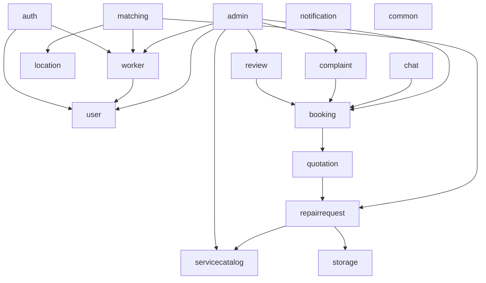
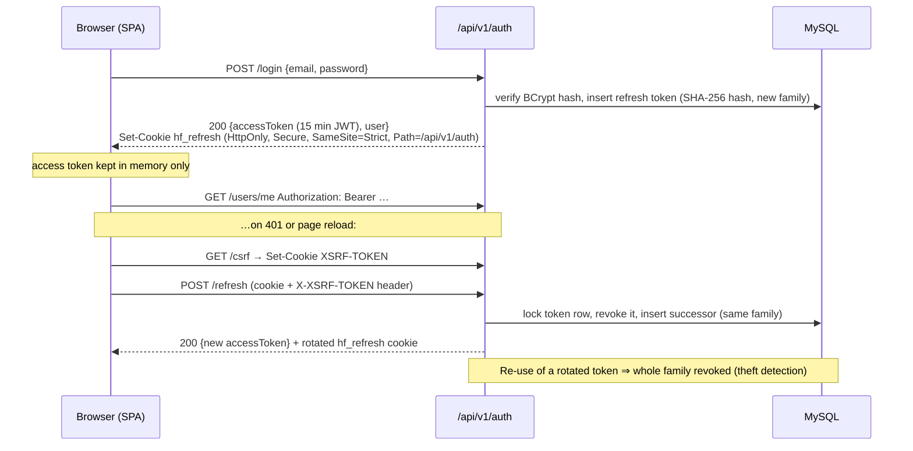
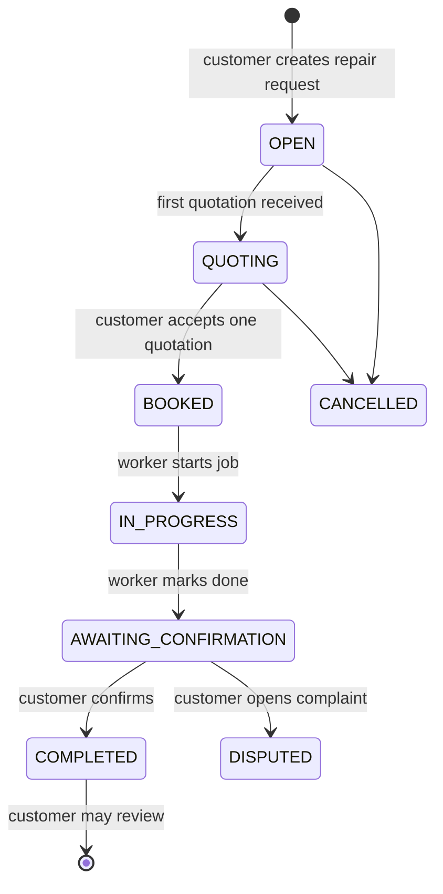

# Architecture

## Overview

HomeFix is a **modular monolith**: one deployable Spring Boot application whose code is split
into business modules with explicit dependencies, plus a React single-page application.
This gives a two-person team one build, one database and one deployment, while keeping
module boundaries clean enough to extract a service later if ever needed
([ADR 0001](decisions/0001-modular-monolith.md)).



In development, Vite's dev server plays nginx's role (it proxies `/api` to `localhost:8080`).
The browser always sees **one origin**, which keeps the refresh-token cookie first-party and
`SameSite=Strict` ([ADR 0002](decisions/0002-authentication-tokens.md)).

## Backend modules

Package root: `com.homefix`. Each module owns its controller, service, repository, entities,
DTOs and mapper. Modules talk to each other through **services and public DTOs**; a module's
repository and entities are an implementation detail even though Java visibility does not
fully enforce it yet.

| Module | Status | Responsibility |
|---|---|---|
| `common` | ✅ | Error model (`ErrorCode`, `BusinessException`, `GlobalExceptionHandler`), `PageResponse`, `AuditableEntity`, security helpers (rate limiter, `@CurrentUserId`) |
| `config` | ✅ | Security filter chain, JWT encoder/decoder, OpenAPI, scheduling, typed `homefix.security.*` properties |
| `auth` | ✅ | Register, login, refresh rotation, logout, CSRF cookie |
| `user` | ✅ (core) | `User` account, roles, account status, `/users/me` |
| `worker` | 🟡 root only | `WorkerProfile` (verification status, availability); skills/areas/schedule in Phase 2 |
| `servicecatalog` | ✅ (read) | Service categories; admin CRUD in Phase 7 |
| `repairrequest`, `location`, `matching` | Phases 3–4 | Requests, media, geodata, worker ranking |
| `quotation`, `booking` | Phase 5 | Quotes, acceptance, booking lifecycle |
| `chat`, `notification` | Phase 6 | STOMP messaging, notifications |
| `review`, `complaint`, `admin` | Phase 7 | Reviews, complaints, moderation, statistics, audit log |
| `ai`, `storage` | Phases 8 / 3 | AI classification adapter, MinIO object storage |

### Dependency rules



- Arrows point from the dependent module to its dependency. **No cycles.**
- Everything may depend on `common`; `common` depends on nothing in the domain.
- When a module needs to *react* to another (e.g. send a notification when a booking changes
  state), use Spring application events instead of a reverse dependency.
- `ai` is consumed only through an interface; nothing else depends on a concrete provider.

### Layering inside a module

```
Controller  → HTTP only: validation (@Valid), mapping path/query params, status codes, cookies
Service     → business rules, authorization on business objects, @Transactional boundaries
Repository  → Spring Data JPA queries
Entity      → JPA mapping; never returned from a controller
DTO/Mapper  → request/response records; MapStruct (unmappedTargetPolicy=ERROR)
```

## Cross-cutting conventions

- **API errors**: RFC 9457 problem details with a machine-readable `code` and optional
  `errors[]` field list — see [api.md](api.md). Security filters route their 401/403 through the
  same handler.
- **Validation**: Jakarta Bean Validation on request DTOs; business validation in services.
- **Transactions**: services are `@Transactional`; read paths use `readOnly = true`;
  `spring.jpa.open-in-view=false`.
- **Concurrency**: `@Version` optimistic locking on mutable aggregates; pessimistic row locks
  or unique constraints where correctness depends on it (refresh-token rotation today; quotation
  acceptance and booking slots in Phase 5).
- **Time**: all timestamps are `Instant` in UTC (`DATETIME(6)`); an injectable `Clock` bean
  makes time-dependent logic testable.
- **Schema**: Flyway only; Hibernate runs with `ddl-auto=validate`, so every test run proves
  that entities match the migrations.
- **Configuration**: environment variables (see `.env.example`), typed and validated at
  startup through `@ConfigurationProperties` records.

## Authentication flow



Details and threat model: [security.md](security.md).

## Main business workflow (target)



The exact request and booking state machines are specified when Phases 3 and 5 start;
transitions are implemented as explicit service methods (no generic "set status" endpoint).

## Worker matching engine (design for Phase 4)

Deterministic and explainable: **filter, then rank**.

1. **Hard filters** (a worker failing any is excluded):
   account `ACTIVE`, verification `VERIFIED`, `available = true`, has a skill for the request's
   service category, request location within the worker's service radius / areas, and has a
   free availability slot covering the preferred time window with no confirmed booking overlap.
2. **Scoring** — every component normalised to `[0, 1]`:

| Component | Weight | Normalisation (initial) |
|---|---|---|
| Skill | 0.30 | 1.0 primary category skill, 0.7 secondary/related; scaled by declared skill level |
| Distance | 0.25 | `1 - d / radius` (Haversine distance `d`, clamped to `[0, 1]`) |
| Reputation | 0.20 | Bayesian average rating `(C·m + Σr) / (C + n)` scaled to `[0, 1]`, so new workers are neither over- nor under-rated |
| Availability | 0.15 | Fraction of the preferred window covered by the worker's free slots |
| Experience | 0.10 | `min(years, 10) / 10`, optionally blended with completed-job count |

   `score = Σ weight_i · component_i`, ties broken by fewer active bookings, then worker id
   (determinism).
3. **Explanation**: the API returns each component's raw value, normalised value and weighted
   contribution, so the UI can show *why* a worker is recommended.

The engine is a `MatchingService` that applies a list of `EligibilityFilter`s and a
`RankingStrategy` (`WeightedScoreStrategy` first). New strategies plug in without touching
filters or callers. Distances use Haversine in Java over candidates pre-filtered by a
bounding-box SQL query; MySQL spatial indexes can be introduced if data volume requires it.

Customer privacy: workers only see an approximate location (district/ward, rounded
coordinates) until they are assigned to the booking.
