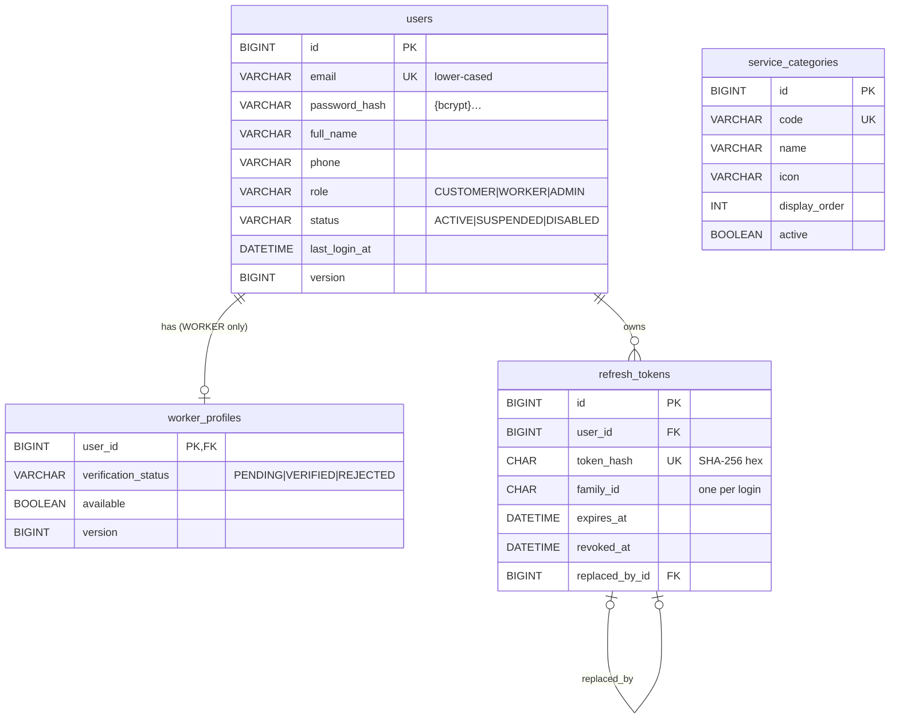
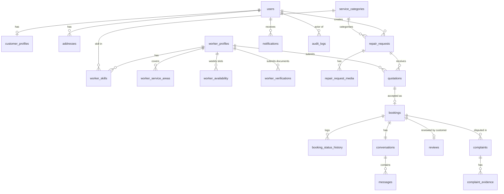

# Database

MySQL 8.4, InnoDB, `utf8mb4` / `utf8mb4_0900_ai_ci`. Schema is owned by **Flyway**
(`backend/src/main/resources/db/migration`); Hibernate only validates it (`ddl-auto=validate`).

## Conventions

| Topic | Convention |
|---|---|
| Names | `snake_case`, plural table names; constraints `pk_*`, `fk_<table>_<ref>`, `uk_*`, `ck_*`, indexes `ix_*` |
| Keys | `BIGINT AUTO_INCREMENT` surrogate keys; 1:1 extension tables share the parent key (`worker_profiles.user_id`) |
| Time | `DATETIME(6)` in UTC (`created_at`, `updated_at` on every mutable table) |
| Enums | `VARCHAR` + `CHECK` constraint (readable, easy to extend with a migration) |
| Concurrency | `version BIGINT` for JPA optimistic locking on mutable aggregates |
| Deletes | Prefer status changes (soft delete) for business data; `ON DELETE CASCADE` only for owned child rows |
| Migrations | Never edit an applied migration. Add `V<n>__description.sql`. Dev-only data lives in `db/dev-seed` (repeatable, loaded by the `dev` profile only) |

## Current schema (V1–V2)

| Migration | Content |
|---|---|
| `V1__auth_and_users.sql` | `users`, `worker_profiles`, `refresh_tokens` |
| `V2__service_categories.sql` | `service_categories` + 8 seeded categories (reference data, all environments) |
| `dev-seed/R__dev_seed_users.sql` | Demo admin / customer / verified worker (dev profile only) |

## Planned schema (by phase)

| Phase | Tables |
|---|---|
| 2 | `customer_profiles`, `addresses`, worker profile columns (bio, years_experience, service_radius_km, base lat/lng, rating_avg, rating_count), `worker_skills`, `worker_service_areas`, `worker_availability`, `worker_verifications` |
| 3 | `repair_requests`, `repair_request_media` |
| 5 | `quotations`, `bookings`, `booking_status_history` |
| 6 | `conversations`, `messages`, `notifications` |
| 7 | `reviews`, `complaints`, `complaint_evidence`, `audit_logs` |

### Key integrity rules planned

- **One accepted quotation per request**: `repair_requests.accepted_quotation_id` (nullable,
  unique) set inside a transaction that locks the request row (`SELECT … FOR UPDATE`) and
  checks status; a second concurrent acceptance fails on the lock/status check.
- **No double booking**: bookings store `worker_id`, `starts_at`, `ends_at`; acceptance locks the
  worker's profile row and checks for overlapping `CONFIRMED|IN_PROGRESS` bookings in the same
  transaction (MySQL has no exclusion constraints).
- **One review per booking**: `uk_reviews_booking (booking_id)`.
- **One quotation per worker per request**: `uk_quotations_request_worker`.
