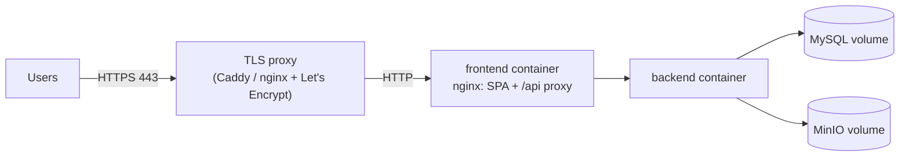

# Deployment

Target for the project: **one Linux VM** (2 vCPU / 4 GB is enough) running Docker Compose,
behind a TLS-terminating reverse proxy. No Kubernetes.



## Steps

1. Provision the VM, install Docker, open only ports 80/443.
2. Clone the repository; create `.env` from `.env.example` with **production** values:
   - `SPRING_PROFILES_ACTIVE=prod` (no demo data, API docs off)
   - strong unique `DB_PASSWORD`, `MYSQL_ROOT_PASSWORD`, `MINIO_ROOT_PASSWORD`
   - `JWT_SECRET=$(openssl rand -base64 48)`
   - `COOKIE_SECURE=true`
   - `CORS_ALLOWED_ORIGINS=https://<your-domain>` (only needed for cross-origin clients)
3. `docker compose --profile app up -d --build --wait`
4. Point the TLS proxy at `127.0.0.1:${FRONTEND_PORT}`, forwarding `Host`,
   `X-Forwarded-Proto: https`, `X-Forwarded-For`. Example (Caddy):
   ```
   homefix.example.com {
       reverse_proxy 127.0.0.1:3000
   }
   ```
   When TLS terminates in front of the frontend container, its nginx must pass the *original*
   scheme and port to the backend; adjust `X-Forwarded-Proto`/`X-Forwarded-Port` in
   `frontend/nginx.conf.template` (or terminate TLS in that nginx directly).
5. Verify: `curl https://<domain>/api/v1/services` and `/actuator/health` from the host.

## Operations

| Task | How |
|---|---|
| Update | `git pull && docker compose --profile app up -d --build --wait` — Flyway migrates on startup |
| Backup DB | `docker compose exec mysql sh -c 'mysqldump -uroot -p"$MYSQL_ROOT_PASSWORD" --single-transaction homefix' > backup.sql` (schedule daily, keep off-host) |
| Backup files | `mc mirror` the MinIO bucket, or snapshot the `minio-data` volume |
| Logs | `docker compose logs -f backend` |
| Health | `GET /actuator/health/liveness` and `/readiness` (container healthchecks use them) |

## Production checklist

- [ ] `prod` profile, HTTPS only, `COOKIE_SECURE=true`
- [ ] Unique secrets; `.env` permissions `600`; not in git
- [ ] MySQL/MinIO ports not exposed publicly (compose binds them to 127.0.0.1)
- [ ] Automated, tested backups
- [ ] Swagger disabled (`API_DOCS_ENABLED=false`) unless intentionally public
- [ ] Single backend instance (in-memory rate limiter); add Redis before scaling out
